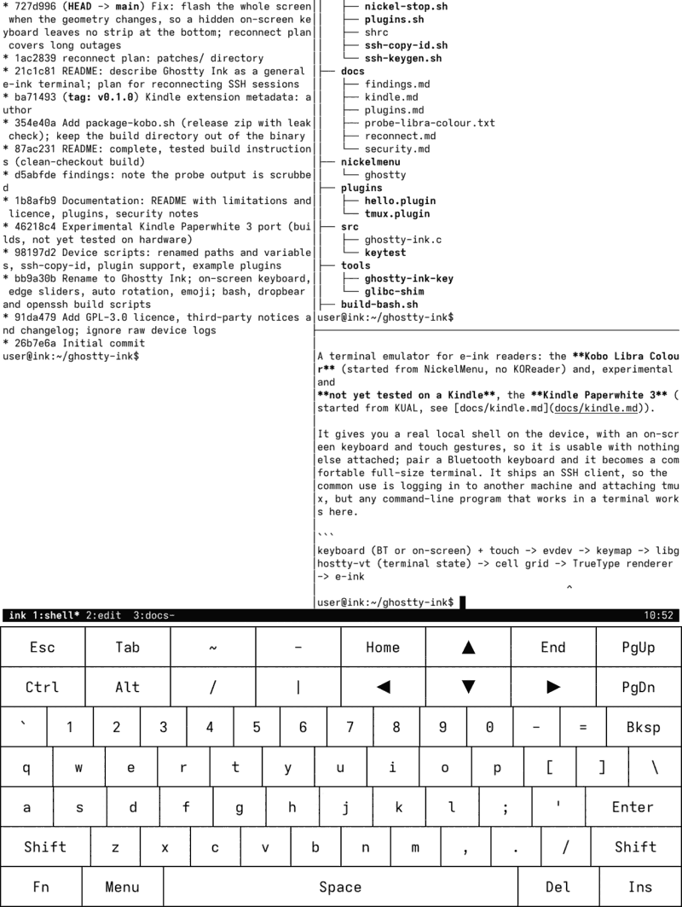
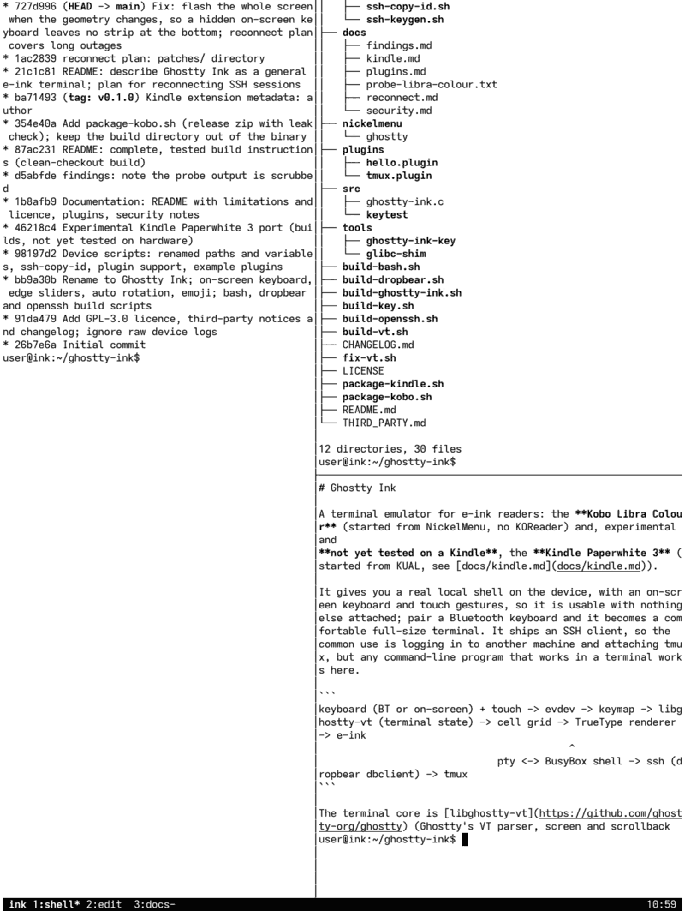
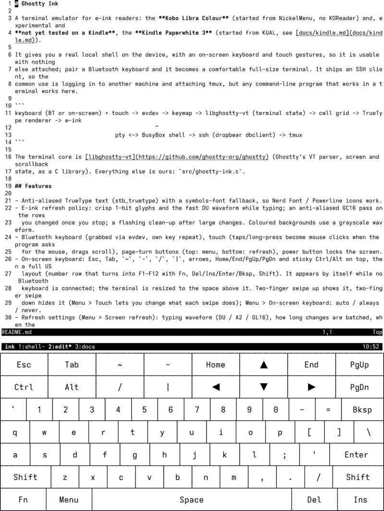
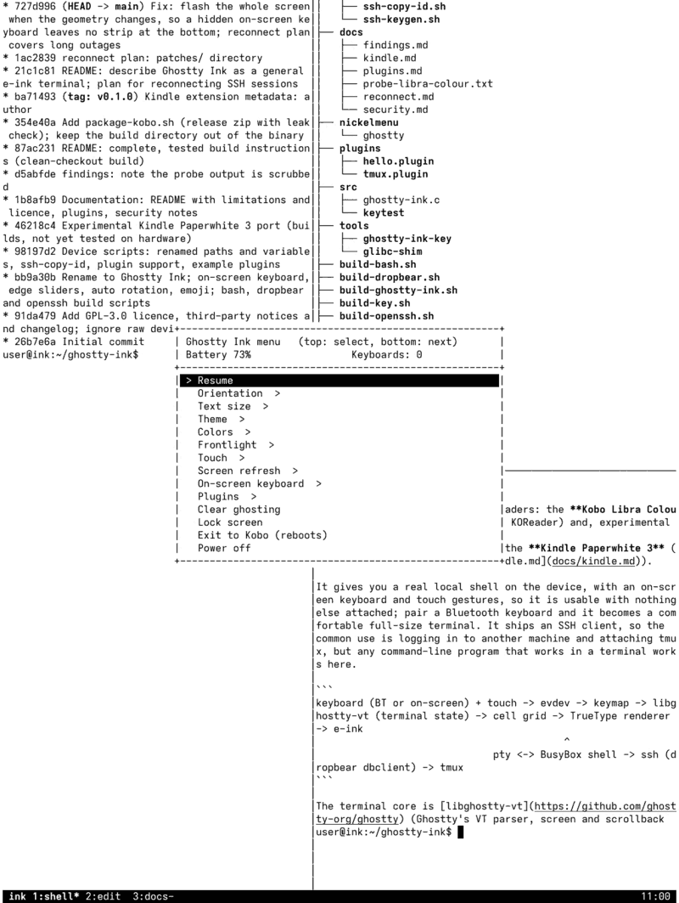

# Ghostty Ink

A terminal emulator for e-ink readers: the **Kobo Libra Colour** (started from NickelMenu) and, experimental and
**not yet tested on a Kindle**, the **Kindle Paperwhite 3** ([docs/kindle.md](docs/kindle.md)).

A real local shell with an on-screen keyboard and touch gestures, plus an optional Bluetooth keyboard and a bundled SSH client
(handy for logging in to another machine and attaching tmux).

## Screenshots

<table>
<tr>
<td></td>
<td></td>
</tr>
<tr>
<td></td>
<td></td>
</tr>
</table>

## Install

Extract the zip from the [latest release](https://github.com/spacequince/ghostty-ink/releases/latest) into the root of your Kobo's
USB drive (needs [NickelMenu](https://pgaskin.net/NickelMenu/)), then tap **Ghostty terminal**. Details: [docs/install.md](docs/install.md).

## Documentation

- [Features](docs/features.md)
- [Install](docs/install.md)
- [SSH and keys](docs/ssh.md)
- [Plugins](docs/plugins.md)
- [Security](docs/security.md)
- [Known limitations](docs/limitations.md)
- [Reconnecting dropped SSH sessions (plan)](docs/reconnect.md)
- [Building from source](docs/build.md)
- [Kindle (experimental)](docs/kindle.md)

## License

GPL-3.0, see [LICENSE](LICENSE) and [THIRD_PARTY.md](THIRD_PARTY.md).
